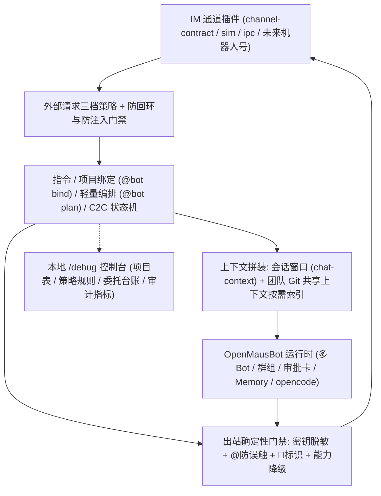

# co-bot 演进路线图（从个人协调助手到团队协作网络）

> 本文档固化 `co-bot`（Coordinator Bot）中长期演进目标、已锁定的架构决策以及 `v0.5` ~ `v0.8` 四阶段交付路线图。

---

## 一、愿景与北极星指标

`co-bot` 的目标是让每个人在现有 IM 中拥有一位常驻**个人协调者（Coordinator）**：对内调度多个专业 Agent 并行推进事务，对外与同事（及同事的 `co-bot`）直接对接，同时依托团队共享 Git 上下文消除重复传话。人只需要做三件事：**提要求、做决定、验收**。

长期演进围绕三项可观测指标衡量：

1. **端到端解决耗时**：一件事务从提出需求到形成可执行结论（或提交改动）的总时间。
2. **单人并行推进事务数**：一个人在同一时段内通过协调者有效推进的任务数量。
3. **人工介入消息数**：整个过程中需要本人阅读、转述、催促或拍板的打扰次数。

---

## 二、已锁定的九项核心设计决策

| 决策维度 | 最终结论 |
| --- | --- |
| **与底层引擎的分工** | **薄编排 + 强确定性治理网关**：底层 Agent 执行、工具运行、审批卡与个人记忆复用 OpenMausBot；`co-bot` 代码层牢牢掌握安全边界、C2C 委托协议状态机、共享上下文桥接与轻量关键流程编排。 |
| **真实 IM 账号形态** | **沿用本人 IM 账号代发**（无独立机器人号），对外通过清晰前缀标识与防回环机制区分本人发言与 AI 回复；通道抽象保留“未来有独立机器人号/应用通知接口时可切换”的能力。 |
| **外部群默认回复与安全门禁** | 保持 `@bot` 原地直发 + `@bot!`（`-p`）私密起草回自聊再 `sendback`，并叠加 **3 道代码级安全门禁**：外部直发带 `🤖` 标识、出站正文/附件密钥凭证脱敏、群聊防 Prompt Injection 数据围栏与回复约束（支持配置切换为默认先回自聊过目）。 |
| **非本人入站触发边界** | 建立统一的**外部请求三档策略引擎**（`auto_readonly` / `confirm_in_self` / `notify_only`），同时承接“同事 `co-bot` 的结构化委托”与“白名单指定同事在群/私聊中的只读提问”；默认档位为 `confirm_in_self`，且代码层严禁外部入口触发任何代码修改或写操作。 |
| **对内多 Agent 编排深度** | **日常直通秒回 + 按需确定性编排**：日常简单问答直接透传主协调 Bot 保持响应速度；补齐 `@bot bind` 项目绑定与只读/可写隔离；复杂需求通过 `@bot plan` 触发轻量确定性闭环（规划 → 代码校验与统一确认 → 调度多 Bot/Thread 执行 → 独立评审 → 汇总）。 |
| **团队共享上下文** | 依托**独立团队上下文 Git 仓库**（约定 `plans/`、`docs/`、`skills/`、`designs/`、`memories/`），通用 Git 优先（任务前轻量同步、按项目/关键词按需检索注入，写入须经本人确认并建分支/提交留痕；个人记忆与自聊记录严格不出本机）。GitLab / GitHub Issue 与 MR 作为可选插件按需挂载。 |
| **C2C 委托协议与离线处理** | **极简双段文本协议**：自然语言正文（人类直接可读）+ 尾部紧凑单行元数据（如 `[cobot:req id=xxx proj=xxx v=1]`）；个人电脑优先，对方协调者关机/离线超时未 `ack` 时自动降级为普通 IM 留言等对方本人处理，同时架构兼容后续将个人实例迁至共用开发机 7×24 运行。 |
| **近期切入点（`v0.5`）** | 优先打牢底座：**确定性安全护栏 + `@bot bind` 项目绑定 + 轻量 `@bot plan` 闭环**。 |
| **配置与管控入口** | **IM 高频指令 + 渐进升级本地 `/debug` 控制台**：常用指令（`@bot bind` / `plan` / `policy` / `ok`）在聊天内完成；项目表、三档策略规则、委托台账与安全审计日志依托本地 `/debug`（零外部前端依赖）逐步演化。 |

---

## 三、目标架构（基于现有插件微内核演进）

沿用 [kernel.js](../src/core/kernel.js) 插件微内核与 [bridge.js](../src/openmausbot/bridge.js) 网关骨架，按阶段增量挂载能力模块：

---

## 四、四阶段迭代计划

### 阶段 1（`v0.5`）：确定性安全护栏 + 项目绑定 + 轻量 `@bot plan`

目标是先将**个人协调者底座与安全红线**固化到代码层面，使单人日常协作即刻受益，并为后续多人互联提供可靠防护。

1. **出站安全与群防注入门禁**（新增 `src/core/security.js`，接入出站队列与桥接层）
   - **出站密钥/凭证脱敏**：所有发送至 IM 的文本与 `.md`/文本附件在出站前经过确定性正则扫描（API Key、Bearer/JWT、私钥段、`*_TOKEN` / `*_SECRET`、数据库连接串等），命中的敏感值替换为 `[已脱敏:<类型>]`，并记录脱敏审计事件至 `/debug`。
   - **外部直发标识与默认流向开关**：外部群与他人私聊直发消息统一前置 `🤖 ` 清晰标识；提供 `chats.externalReplyMode`（默认 `'inline'`，可切换 `'draft_first'` 强制先回自聊过目后再 `sendback`）。
   - **群聊防 Prompt Injection 加固**：升级 `<im-context>` 数据围栏声明与协调者系统人格约束，将群内他人发言与附件严格隔离为不可信数据；遇到诱导泄露系统提示词或越权动作时直接忽略，不在公开答复中提及。
2. **项目注册表与会话绑定**（新增 `src/openmausbot/projects.js`）
   - 在 `config.json` 中支持配置 `projects`（名称、别名、本地路径、权限模式 `readonly | writable`）。
   - 新增指令 `@bot projects`、`@bot bind <项目名>`、`@bot unbind`；按“提问显式提及项目 → 会话已绑定项目 → 无绑定纯对话”三级解析目标项目并注入允许操作范围，无项目上下文时不随意访问无关本地目录。
3. **轻量确定性 `@bot plan` 编排闭环**（新增 `src/openmausbot/planner.js`）
   - 日常简单提问与查询维持直通秒回；发送 `@bot plan <需求>` 时进入 5 步编排状态机：
     1. **只读规划**：调用主协调 Bot 输出结构化 JSON 计划（目标、所属项目、`readonly | writable`、`dependsOn`）；
     2. **代码校验与合并确认**：代码检查项目存在性、DAG 无环性及权限边界；计划中的可写子任务合并为**一张自聊确认卡**（`ok` 启动 / `no` 取消）；
     3. **分派执行**：只读子任务并发推进，同项目可写子任务按依赖串行调度至 OpenMausBot 独立 Thread 或专长 Bot（如 `Plum`）；
     4. **独立评审**：可写任务完成后，拉起独立干净的只读评审任务检查 diff / 产出；未通过则附具体意见退回修正（最多 2 轮）；
     5. **汇总交付**：综合最终结论发回自聊，详细子任务报告附 `.md` 文件，状态持久化防重启丢失。
4. **`/debug` 控制台一期升级**（[inspector.js](../src/plugins/inspector.js) & [debug.html](../public/debug.html)）
   - 展示项目绑定状态、密钥脱敏拦截审计计数/摘要，以及进行中与历史 `@bot plan` 执行进度。

- **阶段验收标准**：群聊注入攻击模拟测试中既不被诱导泄露也不对外回嘴；含模拟 Token/私钥的输出文本与 `.md` 附件 100% 自动脱敏；`@bot bind` + `@bot plan` 在真实仓库上完整跑通“规划 → 确认 → 执行 → 独立评审 → 汇总”端到端闭环。

---

### 阶段 2（`v0.6`）：团队共享上下文（独立 Git 仓库）

目标是不依赖新建中心数据库，利用现有 Git 仓库把团队计划、文档、技能、设计与共同记忆沉淀下来并按需喂给 Agent。

1. **共享上下文插件**（新增 `src/plugins/shared-context.js`、`src/core/shared-context.js`）
   - 团队共享仓库目录约定：`plans/`、`docs/`、`skills/`、`designs/`、`memories/`。
   - **任务前轻量同步**：按 TTL（如 3~5 分钟）在任务前后台静默执行 `git fetch && git pull --ff-only`；离线或出现冲突时自动降级读取本地已有快照并产生告警，不阻塞日常会话。
   - **按需索引与精准注入**：根据当前绑定项目与用户提问关键词检索 Top-K 相关的文档、决策记录与团队记忆摘要注入上下文头，完整内容由 Agent 按路径按需读取。
   - **技能加载与写回留痕**：`skills/` 按 `opencode` / OpenMausBot skill 格式只读挂载；团队记忆、方案文档或计划的写入提议必须在自聊经本人确认后，自动创建分支并提交（附带作者与关联任务追踪信息）；个人记忆与自聊历史不出本机。
   - 新增指令：`@bot ctx sync`、`@bot ctx find <关键词>`、`@bot ctx propose <结论>`。
2. **托管平台可选扩展点**
   - 定义可选 `IssueTracker` / `MergeRequest` 插件接口（未来可挂载内网 GitLab `glab`/Token 或 GitHub `gh`，不强绑平台核心）。

- **阶段验收标准**：新建会话中提出涉及团队约定的需求时能自动命中并引用共享仓库 `docs/` 或 `memories/`；通过自聊确认提议写入一条团队记忆后，Git 仓库生成可追溯、可回滚的独立提交记录。

---

### 阶段 3（`v0.7`）：统一外部策略引擎 + 协调者互联（C2C 委托）

目标是让个人的 `co-bot` 接入外部协作流，同时支持白名单同事直接提问以及协调者之间的点对点委托。

1. **统一外部请求三档策略引擎**（新增 `src/core/inbound-policy.js`）
   - 按 `发送者 × 会话 × 项目` 匹配处理档位：
     - `auto_readonly`：仅针对授权项目范围的只读提问，自动查阅后回复；
     - `confirm_in_self`（**默认**）：分析结果先以草稿形态发回本人的自聊，本人回 `ok` / `确认发送` 才对外发出；
     - `notify_only`：涉及排期承诺、修改代码或超范围问题时，只通知本人处理，绝不代答。
   - 同时兼容**白名单同事直接 `@`**（同事无需部署 `co-bot` 也能提问只读问题）与**同事 `co-bot` 的结构化委托**；代码层始终禁止任何外部入口触发写工具或代码修改。
2. **极简双段 C2C 委托协议与状态机**（新增 `src/openmausbot/delegation.js`）
   - **消息格式**：自然语言正文（带 `🤖 协作请求` / `🤖 协作答复` 前缀，人类可读）+ 尾部单行紧凑协议段（例如 `[cobot:req id=d_xxx proj=order v=1]`），覆盖 `req / ack / ask / prog / res / rej` 状态流转。
   - **防回环与超时人工降级**：基于委托 `id` 去重、发送者绑定校验及最大委托深度/跳数限制；发出请求后若在超时窗口内未收到对方 `ack`（对方电脑关机或尚未接入），自动退回普通人类留言等待模式，不重发骚扰。
   - 新增指令：`@bot ask @同事 <问题>`、`@bot delegations`、`@bot policy`。
3. **`/sim` 多协调者沙箱 & `/debug` 策略委托面板**
   - 在 `/sim` 模拟器增加“同事协调者”模拟节点，无需真实两人联机即可完整回放和测试三档响应策略；
   - `/debug` 新增策略规则清单与 C2C 委托状态台账。

- **阶段验收标准**：在本地 `/sim` 沙箱跑通两台 `co-bot` 节点的自动只读答复、自聊确认后答复、拒绝/转人工以及离线无 `ack` 降级场景，全程零死循环回环。

---

### 阶段 4（`v0.8`）：真实 IM 落地、双人试点与多机弹性

1. **真实 IM 通道插件接入与推送适配**：在具体目标 IM 协议明确后，通过 `im-plugin.js` / `ipc-client.js` 完成 [channel-test.js](../scripts/channel-test.js) 契约测试与真实自聊/群聊收发验证；若手机端对“自己发给自己”的自聊消息无提醒，通过通道可选通知钩子对接应用通知接口。
2. **共用开发机 / 多实例弹性部署**：整理多用户隔离配置（独立 `dataDir`、Web 端口与凭据），支持将原本跑在个人笔记本上的 `co-bot` 平滑迁移至 7×24 在线的共用 Linux 开发机，解决关机后委托无人应答问题；若后续 IM 开放机器人账号，直接在通道插件层切换发信身份。
3. **团队真实试点与指标看板**：在 `/debug` 汇聚展示“解决耗时、并行推进任务数、人工介入次数”三项指标，先联合 1 位协作同事（如产品或后端）开展真实双人试点，再按需激活内网 GitLab Issue/MR 联动插件。
