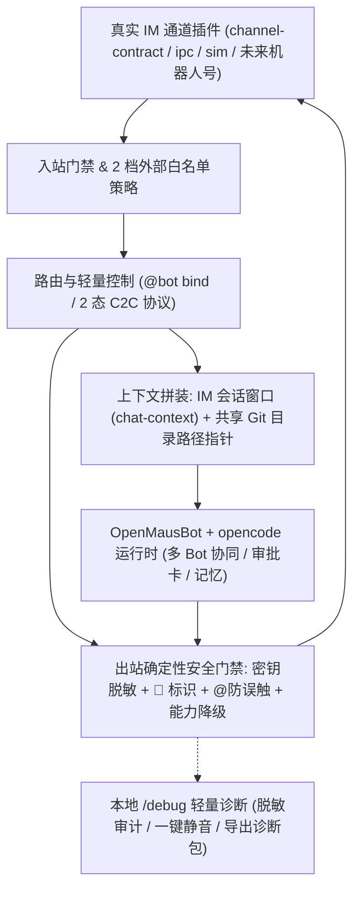

# co-bot 演进路线图（精简三步走：强治理薄网关 → 共享协作 → C2C 互联）

> 本文档确立 `co-bot`（Coordinator Bot）的克制演进路线：只做 OpenMausBot / `opencode` 之上的**强确定性 IM 治理与跨人连接薄网关**，避免与底层引擎重复造轮子，通过三步迭代落地个人安全底座、共享协作与极简协调者互联。

---

## 一、核心定位与克制原则

`co-bot` 的真正护城河只有三件事：**顺手的真实 IM 入口 + 代码层铁打的入站/出站安全边界 + 极薄的跨人连接协议**。凡是 OpenMausBot 或 `opencode` 原生已经擅长的能力，一律下沉给底层引擎，不在 `co-bot` 里重复包装复杂状态机。

### 明确红线（不做什么）
1. **不自建 DAG 多 Agent 编排引擎**：规划、拆解、调度与文件修改交给 OpenMausBot（Chief + 专长 Bot + 协作群）与 `opencode`，写操作安全由 OpenMausBot 原生 `approvalMode: 'ask'` 与 `co-bot` 门禁共同兜底。
2. **不自建共享仓库全文索引与提前平台抽象**：不手写分片检索器或提前耦合 GitLab/GitHub Issue/MR 抽象层；让 `opencode` 直接按路径检索本地同步的共享目录。
3. **不无限膨胀聊天指令数**：已有 27 个内建命令尽量收敛，新增能力优先靠自然语言上下文或配置驱动，只保留极少数高频刚需命令（如 `@bot bind`）。
4. **不把 `/debug` 做成重型 SPA 后台**：保留纯零依赖“只读诊断 + 一键止血 + 安全拦截审计”定位，避免无框架页面堆砌复杂表单与规则编辑器。

---

## 二、北极星衡量指标

演进效果只看三项直观指标：
1. **端到端解决耗时**：一件事从在 IM 提出到拿到可执行结论或完成改动的总时间。
2. **单人并行推进事务数**：一个人在同一时段内借助协调者有效推进的任务数量。
3. **人工介入消息数**：全过程需要本人阅读、传话、催促或拍板的打扰次数。

---

## 三、精简目标架构

沿用 [kernel.js](../src/core/kernel.js) 插件微内核与 [bridge.js](../src/openmausbot/bridge.js) 网关骨架，按需增量挂载治理与连接层：

---

## 四、三步精简演进路线

### Step 1（`v0.5`，已实现）：安全底线 + 极简项目绑定 + 真实 IM 闭环

先把“个人日常用得放心”的硬边界与真实 IM 入口打通——**先跑通真实 IM，再围绕真实约束继续演进**，避免模拟器闭门设计后续返工。

1. **出站安全与群防注入门禁**（新增 `src/core/security.js`，接入出站队列与桥接层）
   - **出站密钥/凭证脱敏**：所有发往 IM 的正文与 `.md`/文本附件出站前执行确定性正则扫描（API Key、Bearer/JWT、私钥块、`*_TOKEN`/`*_SECRET`、数据库连接串等），命中片段统一替换为 `[已脱敏:<类型>]` 并向 `/debug` 记入拦截审计。
   - **外部直发清晰标识与流向切换**：用本人账号在外部群/私聊公开回复时前置 `🤖 ` 标识以防混淆本人发言；同时提供 `chats.externalReplyMode`（默认 `'inline'` 原地直发，可设为 `'draft_first'` 统一先回自聊草稿确认后再 `sendback`）。
   - **群聊防 Prompt Injection 加固**：收紧 [chat-context.js](../src/core/chat-context.js) 的 `<im-context>` 不可信数据围栏与 [persona.js](../src/openmausbot/persona.js) 约束，明确遇到群内诱导套取提示词或越权指令时直接忽略，且不在公开回复里提及。
2. **极简项目绑定（`@bot bind`）**
   - `config.json` 可配置 `projects` 白名单（名称/别名/本地目录），并记录 `chatId -> { name, path }` 轻量映射。
   - 新增唯一高频指令 `@bot bind <项目|路径>`（含 `unbind` / 查看）；按“提问显式提及 → 会话已绑定项目 → 无绑定纯对话”解析，未绑定项目时明确只在对话上下文内作答，不越界翻查无关目录。
3. **优先完成真实 IM 通道接入与提醒验证**
   - 实现实际 IM 的 `im-plugin.js` / `ipc-client.js`，跑通 [channel-test.js](../scripts/channel-test.js) 契约测试与真机自聊/群聊链路。
   - 验证“自己发给自己的消息”手机端是否推送提醒；若无提醒，通过通道可选 `notify` 钩子接入应用通知接口。

- **Step 1 验收标准**：真实 IM 群内 `@bot` 与 `@bot!` + `sendback` 全链路可用；群注入模拟攻击零泄露且零回嘴；含模拟 Token/私钥的回复与 `.md` 附件 100% 自动脱敏；`@bot bind` 能隔离不同群的默认代码工作目录。

---

### Step 2（`v0.6`，已实现）：极薄共享目录 + 白名单同事只读协作

单人用顺后，无需搭建中心服务，先把“共享经验给团队”和“有限度替本人挡一轮外部只读咨询”接进来。

1. **共享 Git 目录指针（无自研索引引擎）**
   - 在 `config.json` 配置 `sharedContextDir` 指向团队共用的 Git 仓库目录；任务触发前按冷却时间（TTL）后台防抖执行一次 `git pull --ff-only`（离线或冲突时降级保留本地缓存并记日志，不阻塞当前对话）。
   - 在提示头中注入 2 行路径指引，让 `opencode` 直接按需查阅团队文档、规范与共同记忆；涉及团队仓库写回提议时必须先在自聊经本人确认，个人记忆与自聊记录严格不出本机。
2. **统一 2 档外部白名单策略引擎**（新增 `src/core/inbound-policy.js`）
   - 取消复杂的三维规则矩阵，聚焦实际有用的 **2 档策略**（代码层铁打硬性禁止外部触发任何改文件/写工具操作）：
     - `confirm_in_self`（**默认**）：白名单同事在外部群/私聊提问时，只读查明后先将草稿发回你的自聊，本人回 `ok` / `确认发送` 才对外发出；
     - `auto_readonly`：仅针对极少数高信任白名单联系人开放，在限定授权项目内查阅只读资料后带 `🤖 ` 标识自动回复。
   - 非白名单外部用户的 `@bot` 依旧 100% 忽略，只作内存窗口背景记录。

- **Step 2 验收标准**：同事在未部署任何插件的情况下在群内提问只读约定，命中白名单后按 `confirm_in_self` 或 `auto_readonly` 正确响应；共享 Git 目录更新可在下一次对话中直接被 `opencode` 检索引用。

---

### Step 3（`v0.7`，已实现）：极简 2 态 C2C 委托 + 弹性部署

当团队内出现第 2 位真实运行 `co-bot` 的试点同事时，再启用点对点协调者通信，避免过早空转联调。

1. **极简 2 态双段 C2C 委托协议**（新增 `src/openmausbot/delegation.js`）
   - 沿用现有 IM 消息传输，**只保留 `req`（请求）和 `res`（结果）2 态**（取消会在本人账号名义下制造刷屏噪声的 `ack / ask / prog / rej` 中间态）：
     - 自然语言正文（含 `🤖 协作请求` / `🤖 协作答复` 标识，人类直接可读）；
     - 尾部紧凑单行元数据标签（如 `[cobot:req id=d_xxx proj=order]` / `[cobot:res re=d_xxx]`）供对端程序识别。
   - **防回环与离线自然降级**：按委托 `id` 去重 + 禁止对 `res` 再触发委托，杜绝无限互发；若对方协调者关机/离线未自动答复，该消息在对方 IM 里天然保留为一条普通人类留言，静待对方本人处理即可。
   - 接收端直接复用 Step 2 的 2 档白名单策略与 Step 1 的出站脱敏门禁，无需另起炉灶。
2. **多机弹性部署与账号抽象落地**
   - 补齐多用户同机隔离运行指南与配置示例（独立 `dataDir`、Web 端口与认证隔离），支持将个人机器上的 `co-bot` 迁往 7×24 在线的共用 Linux 开发机；若后续目标 IM 开放独立机器人号，直接通过通道层配置切换发信主体。

- **Step 3 验收标准**：两台真实 `co-bot` 实例（或单元测试状态机验证）跑通从发出 `[cobot:req]` 到 `auto_readonly` / `confirm_in_self` 返回 `[cobot:res]` 的完整闭环，无回环重发，对端离线时自然转为人工处理。

---

## 五、刻意砍掉 / 延后的设计清单（防复杂度回潮）

为防止后续迭代重新引入过度设计，以下方案已明确从路线图中移除或延后：

| 原设想项 | 裁减 / 延后决定 | 原因说明 |
| --- | --- | --- |
| 自建 `planner.js` 5 步 DAG 编排器 | ❌ 砍掉 | 会与 OpenMausBot 内部 Turn/Queue/Card 状态机形成脆弱双层嵌套；改代码审批复用 OpenMausBot 原生 `approvalMode` 即可，独立评审可由轻量单次调用解决。 |
| `shared-context` 自研全文索引 + 5 目录强规范 + 3 条 `@bot ctx` 命令 | ❌ 砍掉 | 与 `opencode` 原生目录/代码检索及 OpenMausBot `/api/team-*` 重叠；改用 2 行路径指针效果更自然且零维护成本。 |
| 提前封装 `IssueTracker` / `MergeRequest` 平台插件接口 | ⏸ 延后（YAGNI） | 在无真实多平台并行需求前提前抽象容易画蛇添足；真需联动 GitLab 时通过 `opencode` + `glab` 或单一薄适配器实现即可。 |
| 6 态 C2C 协议 + 三维规则矩阵 + `/sim` 多协调者沙箱 | ❌ 简化为 2 态 + 2 档 | 用本人账号代发 `ack/prog` 会造成 IM 刷屏，三维规则矩阵维护过重；协议状态机与防回环直接用单元测试覆盖更稳更轻。 |
| 把 `/debug` 扩建为完整规则/项目/台账 SPA 管理后台 | ❌ 砍掉 | 零前端框架下维护重表单得不偿失；规则配置收口于 `config.json` 与极少 `@bot` 指令，`/debug` 保持只读诊断与应急止血开关。 |
