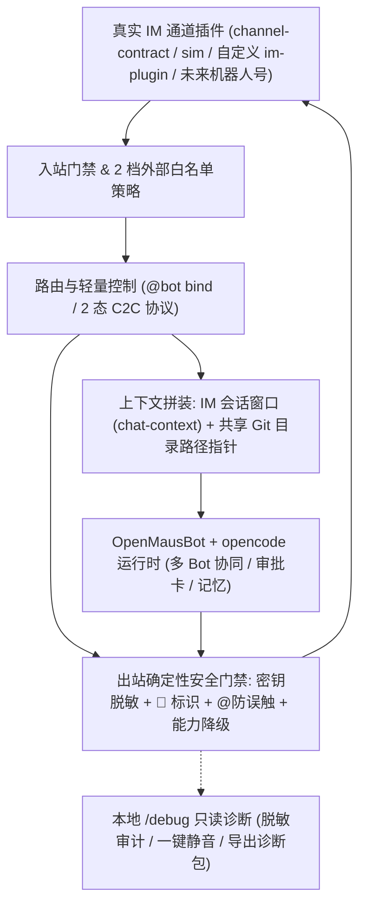

# co-bot 演进路线图

> 本文档确立 `co-bot`（Coordinator Bot）的克制演进原则：**只做 OpenMausBot / `opencode` 之上的强确定性 IM 治理与跨人连接薄网关**，避免与底层引擎重复造轮子。具体日常用法与配置见 [使用指南](./usage.md)。

---

## 一、核心定位与克制红线

`co-bot` 的护城河只有三件事：**顺手的真实 IM 入口 + 代码层确定性入站/出站安全边界 + 极薄的跨人连接协议**。凡是 OpenMausBot 或 `opencode` 原生已擅长的能力，一律下沉给底层引擎。

1. **不自建 DAG 多 Agent 编排引擎**：规划、拆解与改代码交给 OpenMausBot（Chief + 专长 Bot + 协作群）与 `opencode`，写安全由 `approvalMode` 与 `co-bot` 门禁共同兜底。
2. **不自建共享仓库全文索引与提前平台抽象**：不手写检索器或耦合 GitLab/GitHub 平台插件；通过共享目录路径由 `opencode` 直接查阅。
3. **保持命令集克制收敛**：新增能力优先靠上下文或配置驱动，不随意膨胀聊天指令数，只保留高频刚需指令（如 `@bot bind`）。
4. **保持 `/debug` 纯净只读诊断**：零依赖页面专注状态可观测、事件审计、一键静音与诊断包导出，不堆砌重表单或后台规则编辑器。

---

## 二、北极星衡量指标

1. **端到端解决耗时**：问题从在 IM 提出到得出可执行结论或完成改动的总时间。
2. **单人并行推进事务数**：同一时段内借助协调者有效推进的并发事项数量。
3. **人工介入消息数**：全过程需要本人阅读、传话、催促或拍板的打扰次数。

---

## 三、精简目标架构

基于 [kernel.ts](../src/core/kernel.ts) 插件微内核与 [bridge.ts](../src/openmausbot/bridge.ts) 网关骨架：

---

## 四、演进现状与下一步方向

### 已交付里程碑（`v0.5` ~ `v0.7+`，详见 [使用指南](./usage.md)）

| 版本 | 核心定位 | 关键能力 |
| --- | --- | --- |
| `v0.5` | 安全底线与工作区边界 | 出站正文与文本/`.md` 附件凭证脱敏、`🤖 ` 外部标识、`<im-context>` 防注入围栏、`draft_first`、`@bot bind` 目录隔离、`notify` 能力 |
| `v0.6` | 共享上下文与外部协作者 | `sharedContextDir` 非阻塞 `git pull --ff-only` 目录指针；2 档外部白名单只读护栏（`confirm_in_self` / `auto_readonly`） |
| `v0.7` | C2C 互通、动态上下文与插件扩展 | `[cobot:req]`/`[cobot:res]` 2 态委托；`plugins/` 热插拔扩展；统一转发摘要+`/api/context/history` 按需翻页、`@同事` 追问确认与一次性私密回流；完整 [IM 接入协议规范](./IM_PROTOCOL.md) 与 ESLint 千行护栏 |

### 下一阶段方向（`v0.8+`，按真机与团队实测反馈驱动）

- **真实 IM 真机闭环**：完成目标 IM 的 `im-plugin.ts` 接入与移动端自发消息提醒（`notify`）验收，基于真实群聊噪音校准默认降噪策略。
- **团队试点微调**：先在 2 人范围试运行 `sharedContextDir`、`collaborators` 与 `@bot delegate`，按需补充内网专用脱敏规则或适配特定 IM 字数上限。
- **独立机器人号切换（可选）**：待目标 IM 开放独立 Bot 身份后，通过通道插件配置切换并置空 `externalBotPrefix`。

---

## 五、刻意砍掉 / 延后的设计（防复杂度回潮）

| 原设想项 | 决策 | 原因 |
| --- | --- | --- |
| 自建 `planner.js` 5 步 DAG 编排器 | ❌ 砍掉 | 与 OpenMausBot 原生 Turn/Queue/Card 状态机冲突重叠；复用引擎原生机制即可。 |
| 共享仓库全文索引 + 强制目录规范 | ❌ 砍掉 | 与 `opencode` 代码检索能力重复；2 行路径指针更轻量自然。 |
| 提前抽象 Issue / MR 平台插件接口 | ⏸ 延后 | YAGNI；真需联动 GitLab 时直接用 `opencode` 调 CLI 工具即可。 |
| 6 态 C2C 协议 + 三维规则矩阵 + `/sim` 沙箱 | ❌ 简化 | 过多中间态会造成 IM 刷屏，2 态协议 + 2 档策略配合单测更稳更简洁。 |
| 重型 `/debug` SPA 规则管理后台 | ❌ 砍掉 | 零依赖页面保持只读诊断与应急开关，规则统一收口于 `config.json`。 |
